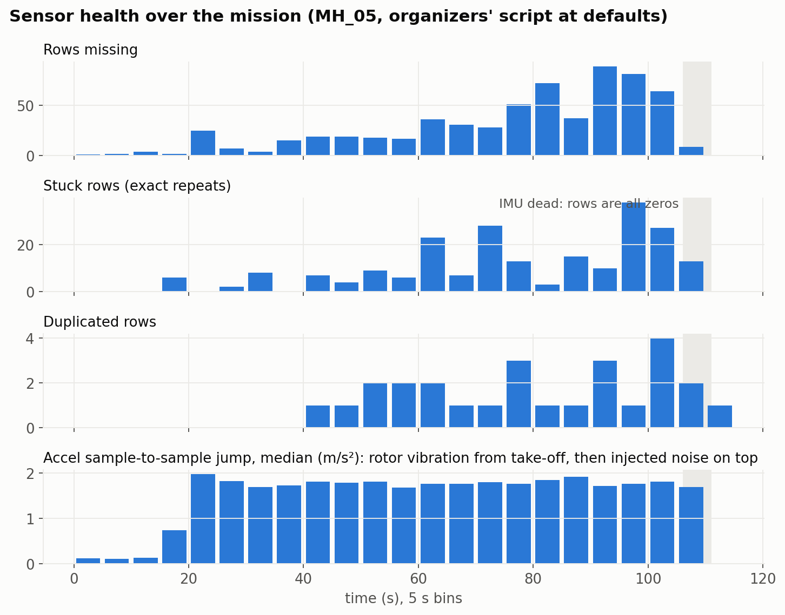
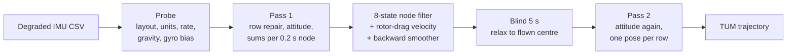

# Path Finder · IMU-only 6-DoF tracking that survives sensor jamming

**Samsung PRISM XR Hackathon 2026 · Track 03 · Team Zero Drift (`VITVellore_ZeroDrift`), VIT Vellore**

-2ea44f)

One Python file, no packages, reads a jammed and dying IMU and writes a full 6-DoF trajectory, including the
5 seconds after the sensor goes dark.

| | |
|---|---|
| **8 of 8** held-out runs beat the never-moving reference | ATE 2.67 m against 2.87 m on sequences we never looked at while building |
| **7× under** the memory budget | 0.84–1.12 MB of Python heap while estimating (limit 8 MB) |
| **13× under** the compute budget | 1.5 ms per second of IMU for the whole process (limit 20 ms) |
| **Zero** assumptions about the file | column order, units, rate, gravity and start attitude are measured, not hard-coded |
| **Byte-identical** output | Python 3.9, 3.12, 3.13, 3.14 on macOS, and Python 3.12 on Linux in Docker |
| **Never fails to deliver** | any internal failure still writes a valid one-pose-per-row trajectory |

## Team

| Name | Registration number |
|---|---|
| Akshat Agrawal | 23MIC0079 |
| Hemang Dubey | 23MIC0069 |
| Ishita Solanki | 23MID0443 |

## Quick start

    python3 src/main.py <imu0/data.csv | folder | zip> [estimated_trajectory.txt]

Nothing to install. Output is `estimated_trajectory.txt` in TUM format (`timestamp tx ty tz qx qy qz qw`,
seconds, unit quaternion), exactly one pose per input row. Details in [src/README.md](src/README.md).

With Docker:

    docker build -t pathfinder .
    docker run --rm -v "$PWD/data:/data" pathfinder /data/imu0/data.csv /data/estimated_trajectory.txt

## The problem

A drone flies a mission on an IMU alone. Jamming escalates: noise, bias drift, stuck samples, spikes, missing
and duplicated rows. Then every reading becomes zero for the last 5 seconds, and the path must still be
predicted. Plain double integration of that accelerometer ended up **8.5 km** off on average across our first
validation flights.
Budgets: 8 MB of memory, 20 ms of compute per second of data, one thread, Python only.

## How it works

1. **Row repair, no thresholds to tune.** Dead (NaN or all-zero), stuck (exact repeat), duplicated and missing
   rows are recognised from the data; a 3-sample median removes one-row spikes at any noise level; integration
   uses the real time step, so missing rows need no special case.
2. **Attitude.** Quaternion gyro integration, gyro bias seeded from the first rows, a gentle pull toward the
   measured gravity direction.
3. **Velocity from physics.** On a multirotor, the accelerometer reading across the thrust axis is proportional
   to speed, because of rotor drag (Leishman et al., 2014). We fitted one coefficient, 0.177 per second, on six
   training flights; its spread across them is 10% (standard deviation over mean). A statistical gate turns the measurement off when
   the data is not rotor flight, so handheld data falls back to bounded dead reckoning.
4. **Offline smoothing.** The organizers allow non-causal processing, so a backward (RTS) pass lets the future
   correct the past.
5. **Two streaming passes.** The file is never held in memory; node records are capped at 2000, so memory does
   not grow with file length (a 15-minute file needs 2.1 MB).

Full design: [docs/ARCHITECTURE.md](docs/ARCHITECTURE.md).

## Results

### Held-out, scored the way the organizers score

Four sequences frozen on day one and never used for any choice (MH_04, V1_03, V2_02 from EuRoC, room6 from
TUM-VI), degraded with the organizers' `degrade_imu.py` at its defaults and its own seed, in both column orders
the brief allows. ATE after SE(3) Umeyama alignment, as in the FAQ.

| Sequence | Ours, order A / B (m) | Never moving (m) |
|---|---|---|
| MH_04, machine hall, drone | 6.63 / 6.65 | 6.81 |
| V1_03, Vicon room, drone | 1.47 / 1.47 | 1.58 |
| V2_02, Vicon room, drone | 1.70 / 1.73 | 2.12 |
| room6, handheld | 0.84 / 0.87 | 0.99 |
| **Mean of 8 runs** | **2.67** | **2.87** |

Blind 5 s: 1.92 m against 2.13 m. Relative position error over 1 s: 0.59 m. Relative rotation error over 1 s:
2.2°. Source: [docs/EXPERIMENTS.md](docs/EXPERIMENTS.md), held-out run 1.

### Why "never moving" is the bar

A tracker that stays at the centre of the flown path is a hard baseline indoors: our own first filter only tied
it, and plain integration missed it by kilometres. Every number we report sits next to it, so nobody has to
take a gain on trust.

### Efficiency (40 of the 100 points)

| 184 s flight | macOS arm64, Python 3.13 | Linux aarch64, Docker `python:3.12-slim` | Limit |
|---|---|---|---|
| Heap while estimating | 1.12 MB | 0.84 MB | 8 MB |
| Heap including one-off compilation of the script | 2.87 MB | 2.58 MB | 8 MB |
| Whole process, per second of IMU | 1.5 ms | 1.6 ms | 20 ms |

Heap is measured with `tracemalloc` started before the script is compiled (`scripts/heap_probe.py`). Measured
instead from the interpreter's first instruction (`python -X tracemalloc`), Python's own start-up adds 3 MB on
macOS and about 6 MB on the Linux image before any of our code runs; the FAQ puts the limit on the algorithm.

## How we kept the numbers honest

- **Frozen split from day one:** train (11 sequences), validation (2), held-out (4). Held-out is report-only,
  with a budget of three runs; one used.
- **Tuned on variants, reported on the real thing:** constants were chosen only on randomised variants of the
  organizers' degradation (other seeds, severities, dropout lengths, both column orders) applied to training
  sequences. The organizers' exact configuration is used only for reporting.
- **Rules fixed before results:** a component ships only if it improves the median by 10%, wins two thirds of
  paired runs and hurts no sequence by more than 25%.
- **Failures are logged, not hidden:** a learned velocity network, a 15-state Kalman filter, a C++ port and a
  looser drag gate were built, measured and dropped. Each has an entry in [docs/DECISIONS.md](docs/DECISIONS.md).
- **No shortcuts:** the estimator never learns which sequence it is reading and never sees ground truth.

## Limits, stated plainly

- An IMU alone cannot hold an absolute position for minutes. The gain over never moving is 7% on held-out data;
  what the method recovers well is attitude and local motion.
- The blind 5 s forecast has no skill beyond "the centre of where the vehicle has been". Coasting on the last
  velocity was tested and was worse (D-026).
- The rotor-drag measurement gains 6% on drone flights, below the 10% bar we set ourselves. It ships as a
  recorded exception, with the evidence (D-025).

## Reproduce everything

Needs Python 3 and `pip install -r requirements.txt` (the submission itself needs nothing).

    python3 scripts/download_euroc.py && bash scripts/download_tumvi.sh       # IMU + ground-truth CSVs only
    python3 -m pytest tests -q                                                # 35 tests
    python3 -m research.eval.run_official --method src/main.py --split val --variant official
    scripts/run_heldout.sh                                                    # held-out report (budgeted)
    scripts/measure_budget.sh research/data/euroc/MH_01_easy/mav0/imu0/data.csv
    scripts/make_zip.sh                                                       # rebuild the submission zip
    python3 -m research.demo.figures && python3 -m research.demo.build_deck   # figures and deck

## Deliverables

| Required (slides 14–17, organizer email) | Where |
|---|---|
| Standalone Python script, degraded IMU CSV to 6-DoF trajectory | [src/main.py](src/main.py) |
| `estimated_trajectory.txt`, `metadata.json`, `src/` in the bundle layout | [submission/VITVellore_ZeroDrift.zip](submission/VITVellore_ZeroDrift.zip) |
| README with reproducible setup, Docker files, requirements | this file, [Dockerfile](Dockerfile), [requirements.txt](requirements.txt) |
| Presentation `CollegeName_TeamName` | [presentation/VITVellore_ZeroDrift.pptx](presentation/VITVellore_ZeroDrift.pptx) |
| Pipeline walkthrough video, 2–3 min | link in the deck and the submission form; script: [demo/VIDEO_SCRIPT.md](demo/VIDEO_SCRIPT.md) |

## Repository layout

| Path | What it is |
|---|---|
| `src/` | The submission: `main.py` and its README |
| `submission/` | The bundle zip in the slide-17 layout |
| `presentation/` | Deck, and the organizers' template it was built on |
| `demo/` | Video script and result figures |
| `research/official/` | The organizers' `degrade_imu.py`, unchanged |
| `research/eval/` | evo-based scorer, format validator, runner, rotor-drag gate |
| `research/explore/` | Tuning sweeps and the prototypes behind each decision |
| `research/baselines/` | Plain integration and our first filter, kept as reference points |
| `research/demo/` | Scripts that build the figures and the deck |
| `scripts/` | Data download, heap and runtime budgets, held-out report, zip |
| `tests/` | Output format, 15 malformed-input cases, forced-crash fallback, memory and runtime gates |
| `docs/` | Decisions, experiments, architecture, rules, organizer FAQ, task log |

Earlier code (C++ port, learned velocity network, our first simulator) is preserved at git tag `pre-cleanup`.

## Acknowledgements

EuRoC MAV dataset (ETH Zürich, ASL) and TUM-VI dataset (TU Munich). Degradation script and brief by the XR
Perception Group and PRISM team, Samsung R&D Institute India, Bangalore. Trajectory scoring with
[evo](https://github.com/MichaelGrupp/evo). Rotor-drag model after Leishman, Macdonald, Beard and McLain,
"Quadrotors and Accelerometers: State Estimation with an Improved Dynamic Model", IEEE Control Systems Magazine
34(1):28–41, 2014, doi:10.1109/MCS.2013.2287362.
