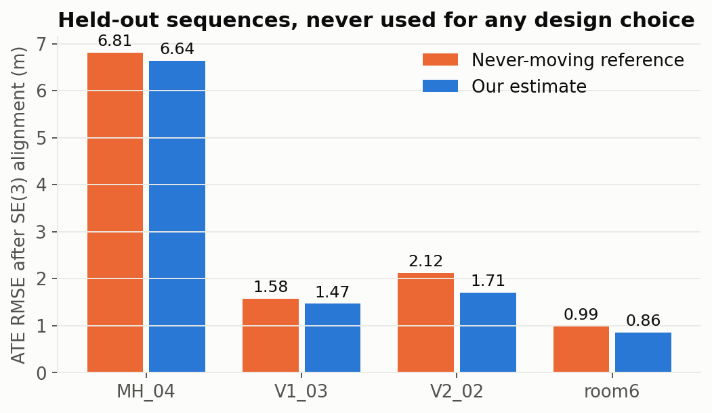
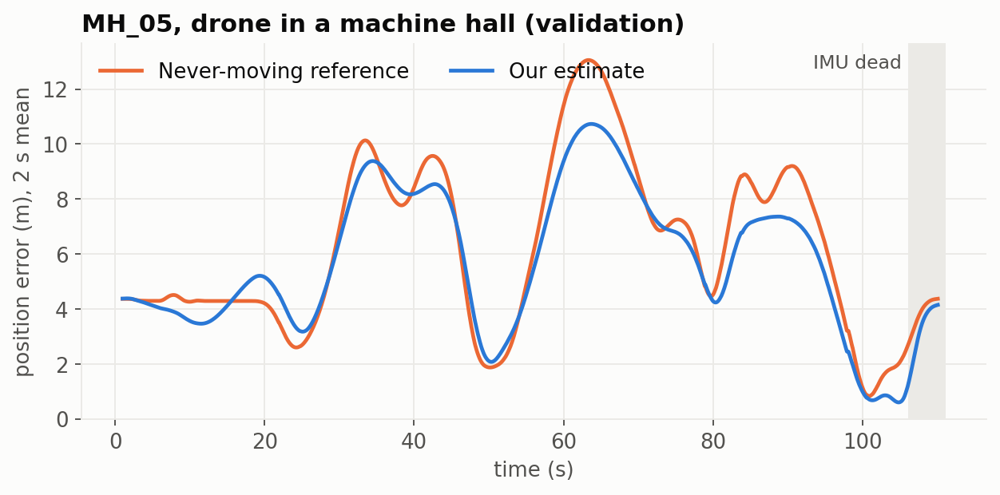

# Path Finder — IMU-only 6-DoF trajectory under sensor degradation

Samsung PRISM XR Hackathon 2026, Track 3. Team Zero Drift (`VITVellore_ZeroDrift`).

Input: a degraded IMU CSV in EuRoC format. Output: `estimated_trajectory.txt` in TUM format, one pose per
input row, including the 5 seconds after the sensor has failed.

## Run the submission

    python3 src/main.py <imu0/data.csv | folder | zip> [estimated_trajectory.txt]

Python 3 standard library only. No packages, one thread, no network. Details: [src/README.md](src/README.md).

With Docker:

    docker build -t pathfinder .
    docker run --rm -v "$PWD/data:/data" pathfinder /data/imu0/data.csv /data/estimated_trajectory.txt

## Results

Held-out sequences (never used for any choice: MH_04, V1_03, V2_02 from EuRoC, room6 from TUM-VI), degraded
with the organizers' `degrade_imu.py` at its defaults and its own seed, in both possible column orders.
Position error after SE(3) alignment, as the organizers score it. "Never moving" is a tracker that stays at the
centre of the flown path; an IMU-only method has to beat it to claim any skill.

| Sequence | ATE, ours (m) | ATE, never moving (m) |
|---|---|---|
| MH_04 (machine hall, drone) | 6.63 / 6.65 | 6.81 |
| V1_03 (Vicon room, drone) | 1.47 / 1.47 | 1.58 |
| V2_02 (Vicon room, drone) | 1.70 / 1.73 | 2.12 |
| room6 (handheld) | 0.84 / 0.87 | 0.99 |
| **Mean of 8 runs** | **2.67** | **2.87** |

Blind 5 s after sensor failure: 1.92 m against 2.13 m. Relative position error over 1 s: 0.59 m.
Relative rotation error over 1 s: 2.2 degrees. Source: `docs/EXPERIMENTS.md`, held-out run 1, commit `8988206`.

Budgets on a 184 s file (limits: 8 MB, 20 ms per second of IMU):

| | macOS arm64, Python 3.13 | Linux aarch64 (Docker `python:3.12-slim`) |
|---|---|---|
| Heap while estimating | 1.12 MB | 0.84 MB |
| Heap including one-off compilation of the script | 2.87 MB | 2.58 MB |
| Whole process, per second of IMU | 1.5 ms | 1.6 ms |

Heap is measured with `tracemalloc` started before the script is compiled (`scripts/heap_probe.py`). If instead
Python itself is traced from its first instruction (`python -X tracemalloc`), the interpreter's own start-up
adds 3 MB on macOS and about 6 MB on the Linux image before any of our code runs, and the totals are 5.4 to 6.6 MB
and 8.0 to 8.3 MB. The organizers' FAQ says the limit applies to the algorithm, not the runtime.
Memory is bounded for any file length: a 15-minute file needs 2.1 MB while estimating, because node records
are capped at 2000. The output file is byte-identical on Python 3.9, 3.12, 3.13, 3.14 and inside the Docker image.

More figures in `demo/figures/` (regenerate with `python3 -m research.demo.figures`). Deck: `presentation/VITVellore_ZeroDrift.pptx`.

## What is honest to say about these numbers

- An IMU alone cannot hold a position for minutes. Our gain over "never moving" is 7% on held-out data. What
  the method does recover is the local shape of the motion and the attitude.
- The blind 5 s forecast has no skill beyond "the centre of where the vehicle has been". We tested coasting on
  the last velocity; it was worse (`docs/DECISIONS.md` D-026).
- The rotor-drag measurement gave a 6% gain where we had fixed 10% in advance as the bar to keep a component.
  It ships as a recorded exception (D-025).
- The method never looks at which sequence it is reading and uses no ground truth (D-021).

## Reproduce the evaluation

Needs `numpy scipy pandas evo pytest`.

    python3 scripts/download_euroc.py && bash scripts/download_tumvi.sh   # IMU and ground-truth CSVs only
    python3 -m pytest tests -q
    python3 -m research.eval.run_official --method src/main.py --split val --variant official
    scripts/measure_budget.sh research/data/euroc/MH_01_easy/mav0/imu0/data.csv
    scripts/make_zip.sh                                                   # submission/VITVellore_ZeroDrift.zip

## Repository layout

| Path | What it is |
|---|---|
| `src/main.py`, `src/README.md` | The submission: the whole estimator in one standard-library file |
| `submission/VITVellore_ZeroDrift.zip` | The bundle in the slide-17 layout: trajectory, metadata, `src/` |
| `presentation/VITVellore_ZeroDrift.pptx` | Deck on the organizers' template |
| `demo/` | Video script and result figures |
| `Dockerfile`, `requirements.txt` | Container for the submission; packages for the evaluation harness only |
| `research/official/degrade_imu.py` | The organizers' degradation script, unchanged |
| `research/eval/` | Scorer (evo), format validator, runner, drag gate |
| `research/explore/` | Tuning sweeps and the prototypes behind the decisions |
| `research/baselines/` | Naive integration and the first filter, kept as reference points |
| `research/demo/` | Scripts that build the figures and the deck |
| `scripts/` | Data download, budgets, held-out report, zip |
| `tests/` | Format, robustness, memory and runtime tests |
| `docs/DECISIONS.md` | Every design decision with its evidence, including the ideas that failed |
| `docs/EXPERIMENTS.md` | Every reported number with its commit |
| `docs/` (rest) | Architecture, rules, organizer FAQ, held-out log, task notes |

The C++ version from before Python became mandatory and the retired neural-net code are in git history at tag
`pre-cleanup`.
