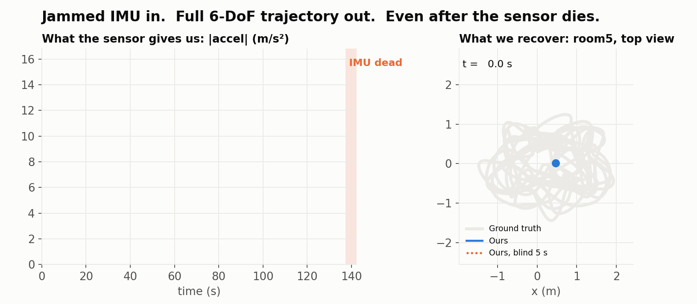
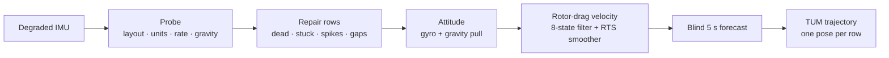

<div align="center">

# Zero Drift · Path Finder

### Jammed IMU in. Full 6-DoF trajectory out. Even after the sensor dies.

**Samsung PRISM XR Hackathon 2026 · Track 03 · Team Zero Drift, VIT Vellore**

[](https://github.com/akshat333-debug/Ghost-Track/actions/workflows/tests.yml)




<sub>room5 (handheld, validation), degraded with the organizers' own script. Plain double integration of this signal ends up kilometres away.</sub>

</div>

## The numbers

| | Zero Drift | Budget / bar |
|---|---|---|
| Held-out runs that beat the never-moving reference | **8 of 8** (ATE 2.67 m vs 2.87 m) | sequences never seen while building |
| Validation runs, any seed, both column orders | **20 of 20** (handheld: up to **45%** better) | organizer script, seeds 1–5 |
| Peak heap while estimating | **1.1 MB** · 7× under | 8 MB |
| Compute per second of IMU | **1.5 ms** · 13× under, ~650× real time | 20 ms |
| Dependencies | **0** · one file, standard library | Python only |
| Malformed inputs survived | **15 / 15** + forced-crash fallback | one pose per row, always |

**Robust where it counts.** The organizers have not said which column order the test file uses, and the script and the slides disagree.
Zero Drift measures the layout itself and beats never-moving in **both** orders.

## Why it matters

| Where | What breaks | What Zero Drift gives |
|---|---|---|
| **GPS-denied aircraft** (the track's brief) | Jamming ramps up IMU noise and bias, then the IMU dies | A pose for every row, a 5 s forecast after failure |
| **XR headsets** (Galaxy XR-class 6-DoF tracking) | Cameras lose tracking in the dark, under occlusion or fast motion | IMU-only failover that keeps the pose alive until vision returns |
| **Wearables and sensor hubs** | No room for numpy, GPUs or big models | ~1 MB, single thread, any Python 3.9+ |

## How it works



- **Self-calibrating front end.** Column order, units, rate, gravity and start attitude are measured, never assumed.
- **Physics as a speed sensor.** On a multirotor, rotor drag makes the sideways accelerometer reading proportional to speed (Leishman et al., 2014). One coefficient; a statistical gate switches it off when the data is not rotor flight.
- **The future corrects the past.** Offline processing is allowed, so a backward smoother refines every node.
- **Two streaming passes.** The file is never held in memory; memory is flat whatever the file length.

Deep dive: [architecture](docs/ARCHITECTURE.md) · [every decision, including what failed](docs/DECISIONS.md)

## Results


Held-out MH_04, V1_03, V2_02 (drone) and room6 (handheld), frozen on day one, scored as the organizers score.
Per-sequence tables, multi-seed runs, efficiency and limits: **[docs/RESULTS.md](docs/RESULTS.md)**.

## Run it

```bash
python3 src/main.py imu0/data.csv estimated_trajectory.txt
```

Nothing to install. Input can be the CSV, a folder or a zip. Docker:

```bash
docker build -t pathfinder . && docker run --rm -v "$PWD/data:/data" pathfinder /data/imu0/data.csv /data/estimated_trajectory.txt
```

Reproduce everything (tests, scores, figures, deck, zip): [docs/REPRODUCE.md](docs/REPRODUCE.md).

## Proof, not promises

- **Held-out discipline.** Train / validation / held-out frozen on day one; held-out has a 3-run budget, 1 used.
- **Tuned on variants, scored on the real thing.** Constants chosen only on randomised degradations of training data.
- **Every number traceable.** Each figure above has a row in [docs/EXPERIMENTS.md](docs/EXPERIMENTS.md) with its commit.
- **35 automated tests** on every push: format, 15 malformed inputs, both column orders, determinism, memory and runtime gates.

## Deliverables

| Required | Where |
|---|---|
| Python script, degraded IMU to 6-DoF | [src/main.py](src/main.py) |
| Bundle: trajectory, metadata, source | [submission/VITVellore_ZeroDrift.zip](submission/VITVellore_ZeroDrift.zip) |
| README, Docker, requirements | this page, [Dockerfile](Dockerfile), [requirements.txt](requirements.txt) |
| Deck `CollegeName_TeamName` | [presentation/VITVellore_ZeroDrift.pptx](presentation/VITVellore_ZeroDrift.pptx) |
| Walkthrough video, 2–3 min | link in the deck and the form |

## Team

**Akshat Agrawal** (23MIC0079) · **Hemang Dubey** (23MIC0069) · **Ishita Solanki** (23MID0443) — Vellore Institute of Technology

<sub>EuRoC MAV (ETH Zürich) and TUM-VI (TU Munich) datasets. Degradation script and brief: XR Perception Group and PRISM, Samsung R&D Institute India, Bangalore. Scoring with [evo](https://github.com/MichaelGrupp/evo). Rotor drag after Leishman, Macdonald, Beard and McLain, IEEE Control Systems Magazine 34(1):28–41, 2014, doi:10.1109/MCS.2013.2287362; the same principle runs in the Paparazzi autopilot's [dragspeed module](https://docs.paparazziuav.org/v5.14/module__dragspeed.html).</sub>
